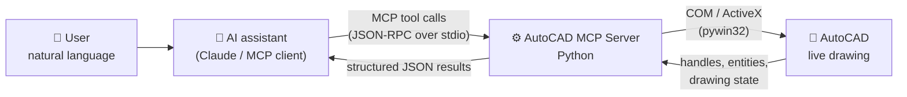

<div align="center">

# AutoCAD MCP Server

**Control AutoCAD in plain English, through Claude or any MCP-compatible AI assistant.**


</div>

---

## Overview

**AutoCAD MCP Server** connects AI assistants to Autodesk AutoCAD. It implements the [Model Context Protocol (MCP)](https://modelcontextprotocol.io), the open standard that lets AI models use external tools, and turns natural-language requests into real drawing operations in a running AutoCAD session.

Instead of clicking through commands, you can tell the assistant:

> *"Draw a 20 × 15 room with 6-inch walls, put a 3-foot door on the south wall, add windows on the east and west walls, label everything, and zoom to fit."*

The assistant plans the steps and calls the server's tools, and the drawing appears in AutoCAD, organized on the right layers.

---

## Key Features

| | Capability | Details |
|---|---|---|
| 🏗️ | **Architectural elements** | Walls, doors with swing arcs, windows with sill lines, and rooms, each with optional labels |
| 🗂️ | **Automatic layers** | 11 standard layers (Walls, Doors, Windows, Electrical, Plumbing, HVAC, ...). Every element is placed on the right one automatically. |
| ✏️ | **Drawing primitives** | Lines, circles, arcs, rectangles and text, with colors and optional wall thickness |
| 🔍 | **Drawing inspection** | Reads drawing info, layers and every entity with its type, layer, color, handle and geometry |
| 🎨 | **Editing** | Recolors any entity by its handle |
| 🧹 | **Targeted deletion** | Deletes by handle, type, layer, color, type + color, the most recent N entities, or everything (with confirmation) |
| ↩️ | **View and history** | Undo and zoom-to-extents |
| 🔌 | **Works with any MCP client** | Claude Desktop, Claude Code, MCP Inspector or a custom client |

**21 tools** in total. See the [tool catalog](#tool-catalog).

---

## How It Works



1. The AI assistant gets the list of available tools and their input schemas from the server.
2. For a request, it decides which tools to call and with what parameters.
3. The server turns each call into AutoCAD COM automation commands, run against the live drawing.
4. Results, including entity **handles**, go back to the assistant, so it can follow up with edits or deletions.

---

## Tech Stack

- **Python**: server implementation
- **Model Context Protocol (MCP) SDK**: tool registration and stdio transport
- **pywin32 / COM automation**: direct control of the AutoCAD application
- **AutoCAD ActiveX API**: model space, layers, entities and views

---

## Engineering Highlights

- **Reliable COM data passing.** Coordinates are sent as typed `VARIANT` arrays, which avoids the type-conversion errors that plain Python lists cause in AutoCAD's API.
- **Self-healing connection.** Every operation checks the AutoCAD session first and reconnects if it was lost, for example after a drawing is closed. If AutoCAD isn't running, the server starts it.
- **Safe bulk deletion.** Entities are collected first and deleted afterwards, so deleting doesn't shift indexes and skip items. Deletion is throttled so AutoCAD isn't overloaded.
- **Fast entity lookup.** Entities are found through AutoCAD's native handle lookup, with a fallback scan if that fails.
- **Rule-based layer assignment.** A keyword map routes each element type ("outlet", "sink", "beam", ...) to the correct layer.
- **Errors as data.** Every tool returns structured JSON (`success` / `error`) instead of crashing, so the AI can understand a failure and retry.
- **Safety on destructive actions.** Clearing the whole drawing needs an explicit confirmation flag.

---

## Getting Started

### Prerequisites

- Windows 10 / 11
- Full AutoCAD (or an AutoCAD-based product such as Civil 3D). AutoCAD LT isn't supported, because it doesn't offer COM automation.
- Python 3.10+
- An MCP client, such as [Claude Desktop](https://claude.ai/download) or Claude Code

### 1. Install

```powershell
git clone https://github.com/initishkumaryadav/Autocad-MCP.git
cd autocad-mcp-server
python -m venv venv
venv\Scripts\activate
pip install -e .
```

### 2. Connect to Claude Desktop

Add this to `%APPDATA%\Claude\claude_desktop_config.json`, using your own path:

```json
{
  "mcpServers": {
    "autocad": {
      "command": "C:\\path\\to\\autocad-mcp-server\\venv\\Scripts\\python.exe",
      "args": ["-m", "autocad_mcp.server"]
    }
  }
}
```

**Using Claude Code instead?** Run this one command:

```powershell
claude mcp add autocad -- "C:\path\to\autocad-mcp-server\venv\Scripts\python.exe" -m autocad_mcp.server
```

### 3. Use it

1. Open AutoCAD with a drawing.
2. Restart Claude Desktop, quitting it from the system tray first.
3. Ask Claude to draw something.

---

## Example Prompts

| Goal | Prompt |
|---|---|
| Inspect | *"What drawing is open, and what layers does it have?"* |
| Floor plan | *"Create a 12 × 10 office with 0.5 thick walls, a door on the south wall, and label it 'Office'."* |
| Electrical layout | *"Add outlets every 8 units along the north wall and a ceiling light in the center."* |
| Organize | *"How many entities are on each layer? Change all walls to red."* |
| Clean up | *"Delete all the text on the ANNOTATION layer, then zoom to fit."* |

---

## Tool Catalog

| Category | Tools |
|---|---|
| **Query** | `get_drawing_info`, `get_entities` |
| **Architecture** | `create_structure` (wall, door, window, room, furniture, electrical, plumbing, hvac) |
| **Primitives** | `create_line`, `create_circle`, `create_arc`, `create_rectangle`, `create_text` |
| **Layers** | `create_or_get_layer`, `set_current_layer` |
| **Edit** | `change_entity_color` |
| **Delete** | `delete_entity_by_handle`, `delete_entities_by_handles`, `delete_entities_by_type`, `delete_entities_by_layer`, `delete_entities_by_color`, `delete_entities_by_type_and_color`, `delete_last_entities`, `delete_all_entities` |
| **View** | `undo_last_operation`, `zoom_extents` |

### Standard Layers

| Layer | Color | | Layer | Color |
|---|---|---|---|---|
| WALLS | White | | PLUMBING | Blue |
| DOORS | Green | | HVAC | Magenta |
| WINDOWS | Cyan | | STRUCTURE | Gray |
| FURNITURE | Yellow | | ANNOTATION | White |
| ELECTRICAL | Red | | SITE | Green |
| UTILITIES | Red | | | |

---

## Project Structure

```
autocad-mcp-server/
├── autocad_mcp/
│   ├── server.py          # MCP entry point: tool registration, dispatch, main()
│   ├── tools.py           # Tool catalogue: name, description, schema, handler
│   ├── config.py          # Colours, standard layers, timing constants
│   ├── geometry.py        # Pure 2D math (offsets, midpoints, rectangles)
│   ├── com.py             # pywin32 helpers (VARIANT points, paced COM calls)
│   └── autocad/           # AutoCAD automation, independent of MCP
│       ├── base.py        #   connection, colour lookup, shared helpers
│       ├── layers.py      #   layer management
│       ├── drawing.py     #   lines, circles, rectangles, text, arcs
│       ├── structures.py  #   walls, doors, windows, rooms, labels
│       ├── query.py       #   drawing info, entity listing
│       └── editing.py     #   delete, recolour, undo, zoom
├── test_mcp_tools.py      # End-to-end test of all 21 tools against live AutoCAD
├── test_script.py         # COM connectivity smoke test
└── pyproject.toml
```

---

## Testing

The project includes an **end-to-end integration suite** that runs every tool against a live AutoCAD session. It checks creation, layer assignment, querying, recoloring, every deletion mode, the error paths and cleanup.

```powershell
python test_mcp_tools.py
```

> ⚠️ The test clears the active drawing. Run it on a blank drawing.


## Acknowledgements

This MCP server was developed with the assistance of an AI coding agent.

---

## License

Released under the [Apache 2.0 License](LICENSE). This project is a modified version of earlier Apache-2.0 licensed code.

<sub>AutoCAD is a registered trademark of Autodesk, Inc. This project is independent and is not affiliated with or endorsed by Autodesk. A licensed copy of AutoCAD is required.</sub>
