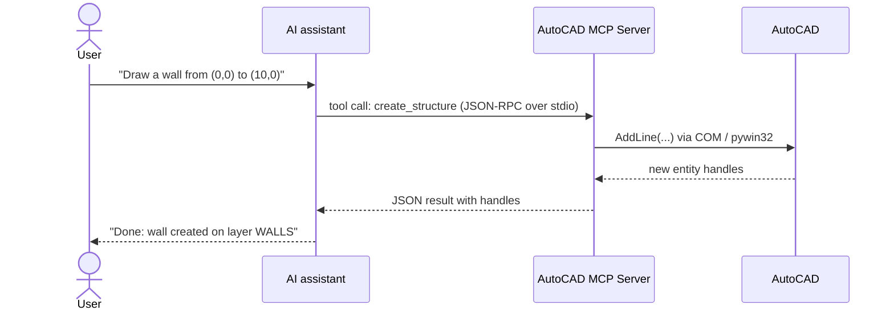

<div align="center">

# AutoCAD MCP Server

**Control AutoCAD in plain English, through Claude or any MCP-compatible AI assistant.**


[Quick Start](#quick-start) · [Tools](#tool-reference) · [How It Works](#how-it-works) · [Troubleshooting](#troubleshooting)

</div>

---

## Overview

**AutoCAD MCP Server** connects AI assistants to Autodesk AutoCAD. It implements the [Model Context Protocol (MCP)](https://modelcontextprotocol.io), the open standard that lets AI models use external tools, and turns natural-language requests into real drawing operations in a running AutoCAD session.

Instead of clicking through commands, you can tell the assistant:

> *"Draw a 20 × 15 room with 6-inch walls, put a 3-foot door on the south wall, add windows on the east and west walls, label everything, and zoom to fit."*

The assistant plans the steps and calls the server's tools, and the drawing appears in AutoCAD, organized on the right layers.

## Contents

- [Features](#features)
- [Quick Start](#quick-start)
- [Example Prompts](#example-prompts)
- [Tool Reference](#tool-reference)
- [How It Works](#how-it-works)
- [Project Structure](#project-structure)
- [Configuration](#configuration)
- [Extending the Server](#extending-the-server)
- [Troubleshooting](#troubleshooting)
- [Limitations](#limitations)
- [Acknowledgements](#acknowledgements) · [License](#license)

---

## Features

| | Capability | Details |
|---|---|---|
| 🏗️ | **Architectural elements** | Walls, doors with swing arcs, windows with sill lines, and rooms, each with optional labels |
| 🗂️ | **Automatic layers** | 11 standard layers (Walls, Doors, Windows, Electrical, Plumbing, HVAC, ...). Every element is placed on the right one automatically. |
| ✏️ | **Drawing primitives** | Lines, circles, arcs, rectangles and text, with colors and optional thickness |
| 🔍 | **Drawing inspection** | Reads drawing info, layers and every entity with its type, layer, color, handle and geometry |
| 🎨 | **Editing** | Recolors any entity by its handle |
| 🧹 | **Targeted deletion** | Deletes by handle, type, layer, color, type + color, the most recent N entities, or everything (with confirmation) |
| ↩️ | **View and history** | Undo and zoom-to-extents |
| 🔌 | **Works with any MCP client** | Claude Desktop, Claude Code, MCP Inspector or a custom client |

**21 tools** in total. See the [Tool Reference](#tool-reference).

---

## Quick Start

### Prerequisites

- Windows 10 / 11
- Full AutoCAD (or an AutoCAD-based product such as Civil 3D). AutoCAD LT isn't supported, because it doesn't offer COM automation.
- Python 3.10+
- An MCP client, such as [Claude Desktop](https://claude.ai/download) or Claude Code

### 1. Install

```powershell
git clone https://github.com/initishkumaryadav/Autocad-MCP.git
cd Autocad-MCP
python -m venv venv
venv\Scripts\activate
pip install -e .
```

Check the dependencies installed correctly:

```powershell
python -c "import mcp, win32com.client; print('deps OK')"
```

If `win32com` fails to import, run `python venv\Scripts\pywin32_postinstall.py -install` once.

### 2. Connect your MCP client

**Claude Desktop:** add this to `%APPDATA%\Claude\claude_desktop_config.json`, using your own path:

```json
{
  "mcpServers": {
    "autocad": {
      "command": "C:\\path\\to\\Autocad-MCP\\venv\\Scripts\\python.exe",
      "args": ["-m", "autocad_mcp"]
    }
  }
}
```

**Claude Code:** run one command:

```powershell
claude mcp add autocad -- "C:\path\to\Autocad-MCP\venv\Scripts\python.exe" -m autocad_mcp
```

**Other clients:** configure a stdio server with the venv's `python.exe` and the args `-m autocad_mcp`. After `pip install -e .`, the `autocad-com-mcp` command does the same thing.

### 3. Use it

1. Open AutoCAD with a drawing. Start it before the client, otherwise the server launches a new AutoCAD instance.
2. Restart your MCP client. For Claude Desktop, quit it from the system tray first.
3. Ask the assistant to draw something.

---

## Example Prompts

| Goal | Prompt |
|---|---|
| Inspect | *"What drawing is open, and what layers does it have?"* |
| Floor plan | *"Create a 12 × 10 office with 0.5 thick walls, a door on the south wall, and label it 'Office'."* |
| Electrical layout | *"Add outlets every 8 units along the north wall and a ceiling light in the center."* |
| Organize | *"How many entities are on each layer? Change all walls to red."* |
| Clean up | *"Delete all the text on the ANNOTATION layer, then zoom to fit."* |

---

## Tool Reference

Points are `[x, y]` or `[x, y, z]`. Angles are in degrees, counter-clockwise from the +X axis. Optional parameters show their default.

### Query

| Tool | Parameters | Returns |
|---|---|---|
| `get_drawing_info` | — | File name, path, saved state, active layer, entity count, all layers |
| `get_entities` | `max_entities` (all) | Every entity with type, layer, handle, color and geometry, plus a per-layer summary |

### Architecture & layers

| Tool | Parameters | Notes |
|---|---|---|
| `create_structure` | `structure_type`, `geometry_data`, `color` (layer color), `thickness` (0), `custom_layer`, `label` | Types: wall, door, window, room, furniture, electrical, plumbing, hvac. The element goes on its standard layer automatically. |
| `create_or_get_layer` | `layer_name`, `color` (white), `description` | Creates the layer only if it doesn't exist |
| `set_current_layer` | `layer_name` | Makes the layer active |

`geometry_data` by structure type:

| Type | Keys |
|---|---|
| wall, window | `start`, `end` |
| door | `start`, `end`, optional `width` (draws a swing arc) |
| room | `corner1`, `corner2` |
| others | any of `start`/`end`, `center`/`radius`, or `corner1`/`corner2` |

### Primitives

| Tool | Parameters |
|---|---|
| `create_line` | `start`, `end`, `color` (white), `thickness` (0) |
| `create_circle` | `center`, `radius`, `color` (white), `thickness` (0) |
| `create_arc` | `center`, `radius`, `start_angle`, `end_angle`, `color` (white), `thickness` (0) |
| `create_rectangle` | `corner1`, `corner2`, `color` (white), `thickness` (0) |
| `create_text` | `position`, `text`, `height` (1.0), `color` (white) |

**Thickness** is drawn as outline geometry: a line becomes a closed strip, and circles and arcs get concentric inner and outer copies.

### Edit, delete & view

| Tool | Parameters |
|---|---|
| `change_entity_color` | `handle`, `color` |
| `delete_entity_by_handle` | `handle` |
| `delete_entities_by_handles` | `handles` |
| `delete_entities_by_type` | `entity_type` (e.g. `AcDbLine`, `AcDbCircle`, `AcDbArc`, `AcDbText`) |
| `delete_entities_by_layer` | `layer_name` |
| `delete_entities_by_color` | `color` |
| `delete_entities_by_type_and_color` | `entity_type`, `color` |
| `delete_last_entities` | `count` (1) |
| `delete_all_entities` | `confirm` (must be `true`) |
| `undo_last_operation` | — |
| `zoom_extents` | — |

### Colors

Use a name or an AutoCAD Color Index (ACI) number such as `"3"`.

| Name | ACI | Name | ACI |
|---|---|---|---|
| red | 1 | magenta | 6 |
| yellow | 2 | white | 7 |
| green | 3 | gray | 8 |
| cyan | 4 | light_gray | 9 |
| blue | 5 | bylayer | 256 |

### Standard layers

Created automatically when the server connects to a drawing.

| Layer | Color | | Layer | Color |
|---|---|---|---|---|
| WALLS | White | | PLUMBING | Blue |
| DOORS | Green | | HVAC | Magenta |
| WINDOWS | Cyan | | STRUCTURE | Gray |
| FURNITURE | Yellow | | ANNOTATION | White |
| ELECTRICAL | Red | | SITE | Green |
| UTILITIES | Red | | | |

### Responses

Every tool returns JSON. Success responses include `"success": true` and the **handles** of the entities created, which you can pass to the edit and delete tools. Failures return `{"error": "..."}` instead of crashing, so the assistant can read the problem and retry.

```json
{
  "success": true,
  "structure_type": "wall",
  "layer": "WALLS",
  "handles": ["2A1", "2A2", "2A3", "2A4", "2A5"],
  "message": "wall created on layer WALLS with label 'North Wall'"
}
```

---

## How It Works



1. The assistant reads the list of tools and their input schemas from the server.
2. For each request, it decides which tools to call and with what parameters.
3. The server turns each call into AutoCAD COM automation, run against the live drawing.
4. Results, including entity **handles**, go back to the assistant, so it can follow up with edits or deletions.

### Design notes

- **Reliable COM data passing.** Coordinates are sent as typed `VARIANT` arrays, which avoids the type-conversion errors that plain Python lists cause in AutoCAD's API.
- **Self-healing connection.** Every operation checks the AutoCAD session first and reconnects if it was lost, for example after a drawing is closed. If AutoCAD isn't running, the server starts it.
- **Paced COM calls.** A short pause after each entity keeps AutoCAD from rejecting calls while it's busy. This trades speed for reliability.
- **Safe bulk deletion.** Entities are collected first and deleted afterwards, so deleting doesn't shift indexes and skip items.
- **Rule-based layer assignment.** A keyword map routes each element type ("outlet", "sink", "beam", ...) to the correct layer.
- **Safety on destructive actions.** Clearing the whole drawing needs an explicit confirmation flag.

**Tech stack:** Python · MCP Python SDK · pywin32 (COM) · AutoCAD ActiveX API

---

## Project Structure

```
Autocad-MCP/
├── autocad_mcp/
│   ├── __main__.py        # enables `python -m autocad_mcp`
│   ├── server.py          # MCP entry point: tool registration, dispatch, main()
│   ├── tools.py           # tool catalogue: name, description, schema, handler
│   ├── config.py          # colors, standard layers, timing constants
│   ├── geometry.py        # pure 2D math (offsets, midpoints, rectangles)
│   ├── com.py             # pywin32 helpers (VARIANT points, paced COM calls)
│   └── autocad/           # AutoCAD automation, independent of MCP
│       ├── base.py        #   connection, color lookup, shared helpers
│       ├── layers.py      #   layer management
│       ├── drawing.py     #   lines, circles, rectangles, text, arcs
│       ├── structures.py  #   walls, doors, windows, rooms, labels
│       ├── query.py       #   drawing info, entity listing
│       └── editing.py     #   delete, recolor, undo, zoom
├── pyproject.toml
└── LICENSE
```

The AutoCAD code doesn't depend on MCP, so you can script it directly from Python:

```python
from autocad_mcp import AutoCADClient

cad = AutoCADClient()
assert cad.connect_to_autocad(), "Start AutoCAD first"

cad.create_structure("wall", {"start": [0, 0], "end": [20, 0]}, thickness=0.5, label="North Wall")
cad.create_circle([10, 10], 2, color="red")
cad.zoom_extents()
```

---

## Configuration

| Setting | Where | Purpose |
|---|---|---|
| `AUTOCAD_MCP_LOG_LEVEL` | environment variable | Set to `DEBUG` to log COM errors to stderr (default `WARNING`) |
| `OPERATION_DELAY` and other delays | `autocad_mcp/config.py` | Pause after each COM call (default 1 s). Lower it for speed if AutoCAD keeps up. |
| `LAYER_DEFINITIONS`, `STRUCTURE_KEYWORDS` | `autocad_mcp/config.py` | Standard layers and the keyword → layer mapping |
| `SERVER_VERSION` | `autocad_mcp/config.py` | Package and server version |

---

## Extending the Server

Adding a tool takes two steps:

1. **Implement the operation** as a method in the matching mixin under `autocad_mcp/autocad/`. Decorate it with `@autocad_operation("<action>")` so it gets the connection check and error handling, and create entities through `self.add_to_model_space(...)`.
2. **Register it** by appending a `ToolSpec` to `TOOLS` in `autocad_mcp/tools.py`. Listing and dispatch are automatic.

To try tools by hand, use the MCP Inspector:

```powershell
npx @modelcontextprotocol/inspector "C:\path\to\Autocad-MCP\venv\Scripts\python.exe" -m autocad_mcp
```

---

## Troubleshooting

| Symptom | What to do |
|---|---|
| `Not connected to AutoCAD` | Start AutoCAD and close any open dialogs or running commands, then retry |
| A second, empty AutoCAD window appears | No running instance was found, so the server launched one. Start AutoCAD before your MCP client. |
| Tools don't appear in Claude Desktop | Use the absolute path to the venv's `python.exe`, fully quit Claude from the tray, and check `%APPDATA%\Claude\logs\mcp*.log` |
| `ModuleNotFoundError: autocad_mcp` | Run `pip install -e .` inside the venv |
| `ModuleNotFoundError: win32com` or DLL errors | Run `python venv\Scripts\pywin32_postinstall.py -install` |
| "Call was rejected by callee" | AutoCAD is busy. Press `Esc` in AutoCAD and avoid using it while tools run. |
| Entities created but not visible | Call `zoom_extents`, then check layer states with `get_drawing_info` |
| Some entities not deleted | They're on locked layers. Unlock the layer in AutoCAD. |
| One undo didn't fully revert a tool call | One tool call can create several undo steps. Call `undo_last_operation` again, or delete by handle. |

---

## Limitations

- Windows and full AutoCAD only (COM automation).
- Model space only. There are no tools yet for saving, opening, plotting, blocks, dimensions or hatches.
- Creation is deliberately paced, so large drawings take a while.
- Connecting adds the 11 standard layers to whichever drawing is open.

---

## Acknowledgements

This MCP server was developed with the assistance of an AI coding agent.

---

## License

Released under the [Apache 2.0 License](LICENSE). This project is a modified version of earlier Apache-2.0 licensed code.

<sub>AutoCAD is a registered trademark of Autodesk, Inc. This project is independent and is not affiliated with or endorsed by Autodesk. A licensed copy of AutoCAD is required.</sub>
